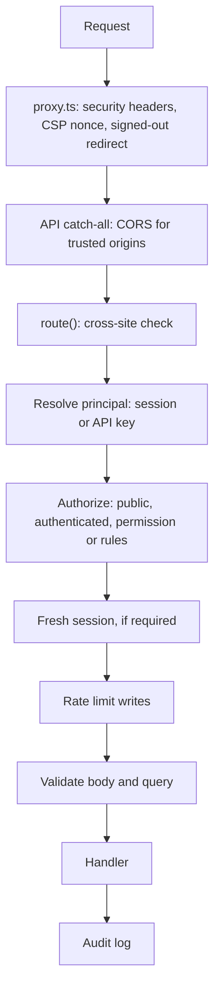

<!-- Paths below are relative to packages/cms (core/, components/, lib/) and apps/starter (app/, proxy.ts, cms.*). -->
# Security model

How authentication and authorization work in tansy, and the rules all new code must follow. The rules are enforced by lint and tests, so code that breaks them does not merge.

## Rules for new code

1. **Every API route is exported as `route({...}, handler)`** from `core/authz/guard.ts`. There is no default access level: each route declares one of `public` (with a reason), `authenticated`, `permission`, or `rules`.
2. **Permissions live in one catalogue**, `core/authz/permissions.ts`. Never check a role name in code. Check a permission.
3. **Database access stays in `core/`.** `app/` and `components/` cannot import Prisma or better-auth's server APIs.
4. **Every `app/dashboard/**/page.tsx` is a server component that calls `requirePage(...)`.** Client UI goes in a sibling `page.client.tsx`.
5. **Hiding a button is not authorization.** The guarded API route is the real check. The UI only reflects it.
6. **Record access goes through `authorizeRecord` or `decideRecord`** (`core/authz/records.ts`), so collection API rules always apply. Anything serving records in a new way, such as realtime, expand or file downloads, must call them too.
7. **Every write declares an `audit` action.** Never put secrets, tokens or passwords in audit metadata.
8. **Management routes take sessions only.** `apiKey: true` is for data routes. Sensitive actions set `fresh: true`.
9. **Grants can never exceed the granter.** Use `assertCanManage` and `assertRoleAssignable` for anything touching users or roles.
10. **Validate all input with Zod in the route options.** Never pass a request body straight to a query.
11. **Get better-auth only through `getRuntime()`.** It's rebuilt when dashboard settings change, so never cache the instance.
12. **Raw SQL never names a record table unreviewed.** Kysely queries are scoped by `core/scope/plugin.ts`, but `sql` templates aren't. A new one naming a `rec_` or `loc_` table must add the scope itself and be added to the reviewed list in `tests/unit/scope.test.ts`. Work outside a request that touches records runs in `unscoped(reason, ...)`.
13. **Don't relax the checks.** If `tests/contract` fails, fix the code. A changed access manifest (`tests/contract/access-manifest.json`) must be reviewed like a security change.

| Rule | Enforced by |
|---|---|
| 1, 3 | ESLint (`eslint.config.mjs`) and contract tests |
| 12 | `tests/unit/scope.test.ts` |
| 4, 6, 7, 8 | Contract tests (`tests/contract/auth-model.test.ts`) |
| 2 | TypeScript: `Permission` is a closed union |
| All | CI (`.github/workflows/ci.yml`) and `tests/integration` |

## Request flow



The cookie check in `proxy.ts` only gives signed-out visitors a tidy redirect. It grants nothing.

## Two layers of authorization

**Roles (who can operate the system).** A role is a set of `resource:action` permissions, edited in **Dashboard → Roles**. Roles are passed to better-auth's admin plugin, so both agree. `superadmin` always holds every permission and cannot be edited.

**Per-collection record permissions.** `record:update` covers every collection. `record:update@c12` covers only the collection with id 12, and the role editor shows these as a grid under **Records by collection**. Grants name the id, not the slug, so renaming a collection keeps them. Collection schema permissions (`collection:*`) are global only.

- Code never compares these strings itself. Record checks go through `holdsRecordPermission` (`core/authz/permissions.ts`), which `decideRecord`, `readableFields`, the scheduler and previews use.
- A route that requires a `record:*` permission and acts on one collection sets `scope: "collection"`. The guard then accepts a grant for the collection whose numeric id is the `id` param. Dashboard pages pass `{ collection: id }` as the first argument to `requirePage`.
- A grant can only name a collection that exists, and deleting a collection removes its grants from roles. Ids are never reused, so a leftover grant would match nothing anyway.
- `isSubset` treats `record:update` as covering `record:update@c12`, so anyone holding the global permission can grant the scoped one, and API keys follow their owner the same way.

**Own-record permissions.** `record:update@c12:own` covers only the records in collection 12 whose `createdById` is the caller. They exist for `list`, `read`, `update` and `delete`, never `create`, and not on views, whose rows have no creator. The role editor shows them as "own" beside each collection's grants.

- `decideRecord` applies them after role permissions and before the API rule: the caller's own record is allowed. Anyone else's goes to the rule, and where the rule is locked it is refused as "denied", a 404, so an own grant never reveals that other records exist. A list adds `createdById = @request.auth.id` to the list rule with `||`, compiled like any rule, so both databases agree.
- They only add to what the rule allows. Someone with no id and a record with no creator never match.
- `record:update` and `record:update@c12` both cover `record:update@c12:own` for granting and API keys. The own grant covers neither.
- A route that acts on one record sets `scope: "record"`. Its guard accepts an own grant as well as a full one, and the handler must then check the record through `authorizeRecord`, as `requireRecord` does for drafts, revisions, schedules and preview tokens. `scope: "collection"` keeps accepting full grants only. Dashboard pages that load records through the guarded API pass `{ collection: id, own: true }` to `requirePage`. Creating a record has no own form, so its page doesn't.
- Hidden fields: with an own read grant they show on the caller's own records, as on the draft and revision routes. Filters, sorting and `expand` still need `record:read` to use them.
- The scheduler and preview tokens count an own grant only while the record is still the person's.
- The dashboard home lists collections where the person holds `record:read` in either form. Where it's only an own grant, the drafts and schedules lists and their counts cover only their own records, the 5,000 they updated last, so the totals reveal nothing about anyone else's.

**API rules (who can reach which record).** Each collection has five PocketBase-syntax rules, edited on the collection's **API rules** page.

| Value | Meaning |
|---|---|
| `null` | Locked. Only roles with the matching `record:*` permission, for all collections or this one. This is the default |
| `""` | Public, including signed-out visitors |
| Expression | Evaluated per record, e.g. `status = "published"`, `@request.auth.id = createdById` |

Failures follow PocketBase: a failed list rule filters results, a failed create returns 400, a failed view, update or delete returns 404, and a locked rule returns 403. Evaluation errors deny access, and rules with unknown field names are rejected when saved.

**Reading records** (`GET /api/collections/:slug/records`):

- A caller's `filter` is always ANDed with the list rule, so it can only narrow results. It can name only columns the caller may read, and can't use `@collection`.
- **A filter may follow one relation** (`core/content/relations.ts`), as in `author.name = "Ada"`, or backwards as `posts_via_author.title ?= "x"`. Each such comparison is answered before the query runs: the target collection is read, every row goes through its own **view rule** with `decideRecord` — the same gate `expand` applies — and the comparison itself is answered by the evaluator, so it means on the target exactly what it would mean on a record of that collection, on either database. What reaches the query is a condition on this collection's own ids, built only from rows that passed. So a filter can't probe a record the caller may not view: a refused row is simply not among the ids, and the caller learns nothing it couldn't learn by reading the target collection itself.
  - Only a field of the target the caller may filter on, so a `hidden` field can't be followed, and the relation field itself must be one they may read.
  - One relation deep, one relation per comparison, and never a relation compared with another relation, so a filter can't be built into a join of its own.
  - A relation that can hold several records, which includes every reverse path, takes the "any" operators (`?=`, `?~`), because the plain ones ask every value to match.
  - A view collection can't be followed, having no rules of its own that `decideRecord` could apply.
  - The comparison is pushed into SQL first, as a condition that can only leave out rows the evaluator would have rejected anyway (`narrowingWhere`), so the target is read down to the rows that could match and nothing else. The evaluator still decides on what comes back, so the answer is the same either way: on Postgres a compiled comparison can use an index, and on SQLite it runs the same `rule_compare` a list rule does. A condition that can't be compiled reads the whole target rather than guessing.
  - The **view rule is not** pushed down with it, because `decideRecord` lets a holder of `record:read` past the rule entirely: narrowing by the rule would then hide rows that caller may see. Deciding when the rule applies is `decideRecord`'s, and there is one copy of that.
  - Read at one moment, like `@collection` lookups, and capped the same way: more than 10,000 **matching** records answers `FILTER_TOO_BROAD` rather than filtering from part of the table. A large target collection is fine as long as the filter is selective.
  - **Saved rules can't follow a relation**, and neither can a realtime filter. A rule is compiled, or evaluated per row, with no chance to read another collection, and a realtime filter is checked per event per client; both refuse such a path rather than guessing. Every path that could reach one fails closed: an unresolved relation comparison denies the whole rule (`relationWhere`, `assertEvaluable`).
- Every expanded record, forward or reverse, must pass its own collection's view rule. Records that fail are left out without an error.
- `hidden` fields are visible only with `record:read`. Without it they can't be returned, filtered, sorted on or followed by `expand`, on these routes or the `content` routes. Rules can still read them.

**Stream fields and blocks:**

- Block types are schema, so `/api/block-types` uses the `collection:*` permissions, needs a fresh session and takes no API keys.
- Blocks are validated at every depth on the server. Block fields can't be `hidden`, `unique` or `readonly`, because those need a column or per-record handling and would look enforced without being so. Hide a whole stream field instead.
- A block with a deleted type or an old version skips validation only if it is identical to the block already stored under that id. Anything else is refused, so this can't be used to save unchecked values.
- Links inside blocks are checked in the write transaction and indexed in `RecordRef`. A record can't be deleted while a block links to it.
- `?expand=<stream field>` serves links inside blocks, by block id and field name. Each record must pass its own collection's view rule, as for reference fields, and hidden fields stay hidden.
- Rich text is an allowlist of TipTap nodes and marks, and links must be `http`, `https` or `mailto`. `<RichText>` builds React elements and re-checks links, so stored content can't become HTML or a script link. Never render rich text with `dangerouslySetInnerHTML`.

**Files:**

- A file is readable by holders of `file:read`, by its uploader, and by anyone who can view a record using it, through `decideRecord`. That covers files inside blocks, and a `hidden` field grants nothing unless the caller may read it. Anything else gets a 404, so a file's existence isn't revealed. A file used by more than 1,000 records is checked against the first 1,000 only, and refused past that.
- `FileRef` holds those links and is written in the record's transaction. Removing a file from its last record ends public access to it. A file on a live record or a pending draft can't be deleted, and neither can one a record in the trash used (`TrashedFile`), so a record can't come back without its images. Old revisions don't protect a file, so it can still be removed for good, and restoring such a revision then fails on that field. A trashed record's files grant no access while it is in the trash: only a live record's `FileRef` rows do.
- A link grants access, so a caller can only attach a file they uploaded, one already on that record, or any file with `file:read`. Otherwise anyone who learned an id could attach it to their own public record and read it. A refused file gets the same error as a missing one.
- A file carries text: an image's alternative text, a caption and a credit, per language (`core/files/text.ts`). `file:update` describes any file, and a file's uploader may describe theirs without it, since they can already read it. `/api/files/:id/text` reads each language's own words for editing and writes them, and answers anyone else as a file that isn't there, so it can't be used to probe for ids.
- Describing a file, and placing its focal point, is allowed only for a file of the work's own scope value. Every value can read the instance's shared files, such as a common logo, so without that a tenant's editor could rewrite what another tenant's page says an image shows, or move its crop.
- A file's focal point (`core/files/focus.ts`) is two percentages that decide what a cropping thumbnail keeps. It is part of the thumbnail's key, so a new point can't serve the crop made for the old one, and it is bounded to 0-100 before it reaches sharp's `extract`, which is given a rectangle computed from the stored width and height, never from the client.
- **Replacing a file's bytes** (`PUT /api/files/:id/bytes`) needs `file:update`, never the uploader alone: the bytes are published wherever the file is used, which is more than whoever uploaded it can see. Only a file of the caller's own scope value, for the reason above. The type may not change kind — the same type, or another raster image for an image — because a field's `allowedTypes`, a thumbnail and a theme all expect what was there before, and the new type comes from the bytes as an upload's does. The new bytes go to a key of their own and the old key and its thumbnails are deleted, so a CDN or a signed URL can't serve what was replaced. Links, text and focal point are unchanged, since the file is the same file.
- A record carries the text of the files it uses, and where each picture's subject is, under `files`, so a page renders alt text and crops without a read per file. Only files in fields the caller may read are included, and in a localized collection only the languages the record was read in, since a localized field's files belong to that translation. The text is no more sensitive than the file itself, which the same caller may already open.
- `maxSize` (bytes) and `allowedTypes` are enforced when a file is attached. Files already on a record stay if the limits later tighten.
- The stored type comes from the file's bytes. What the client claims only chooses among formats whose bytes look alike. `image/*` means raster images, so SVG must be named.
- Only raster images, video and audio render inline. Everything else, including SVG, HTML and PDF, downloads, with `nosniff` and a sandboxing CSP.
- Buckets stay private. Every read passes the guarded route, then redirects to a URL signed for 5 minutes or, with no signed URLs, streams from the CMS. Dashboard previews are thumbnails served by the CMS, so the dashboard's CSP needs no bucket origin.
- An adapter may hand thumbnails to the provider's image service (`thumbnailUrl`), after the same access check. A URL that expires is a 5-minute redirect, so its origin must be in `csp.img`. One that doesn't is fetched by the CMS and never sent to a browser, and only a raster image of at most 10 MB is passed on ([guides/storage.md](../guides/storage.md)).
- `POST /api/files/:id/token` gives a caller who can read a file a token for that file alone, valid 2 minutes. It can't be revoked sooner, and rotating `BETTER_AUTH_SECRET` voids all of them. Tokens never reach the audit log.
- `/api/files/upload` is excluded from `proxy.ts`, which grants nothing, because Next.js cuts proxied bodies off at 10 MB. The route is still guarded and enforces its own limit.
- Storage adapters only move bytes. Keys are generated by core and never hold user input, so a plugin can't weaken any rule above.

**Revisions, drafts and schedules:**

- Snapshots include hidden fields, so these routes need `record:read`, for the collection or as an own grant on that record, and never open through API rules, even on a public record. Writes also need `record:update`. Each route still passes through `authorizeRecord`.
- A draft of a published record lives only in `Revision`. The live row is untouched until it is published, so public reads, rules and filters can't see it.
- Saving a draft runs the same validation and file claim check as a normal save. Because of that, publishing a draft or restoring a revision doesn't repeat the claim check for whoever does it. Field limits and link checks do run again.
- A scheduled action runs with the authority of the person who scheduled it, checked when it runs. If they lost `record:update`, an own grant no longer covers the record, or they were banned, it fails, stays visible with the reason, and isn't retried.
- A history snapshot grants no file access. Only the live record's `FileRef` rows do.

**Importing records** (`core/content/import.ts`):

- `POST /api/collections/:id/import` needs `record:create` for that collection, and `record:update` as well before a row may update an existing record through `keyField`; a row that matches one without it fails with its own error rather than the whole request. API rules don't open an import, as they don't open a schema import.
- Every row goes through the same write path as a save: validation, hooks, history, search, webhooks and the review gate (`assertMayPublish`), so an import can't put in anything the editor couldn't, and published rows in a collection that requires review need `record:publish`.
- A column that names no field is refused up front, so a typo can't silently drop content. Values are read into the field's own kind of value, and a reference or file column names ids, which are then checked as any save's are: a file the caller may not attach is refused.
- Each row is its own transaction, bounded at 2,000 rows and 12 MB per request, so one import can't hold the write lock or the server's memory. `dryRun` validates every row and writes nothing.
- The audit entry records the collection, whether it was a dry run, and how many rows were added, updated and failed. Rows' values never reach it.

**The trash** (`core/content/trash.ts`):

- Every way of deleting a record — the content and records APIs, batch, MCP, a plugin's `records.delete` and the dashboard — writes a trash entry in the delete's own transaction, unless Settings → Security → Trash turns it off, which makes deletes permanent again. A record is never gone without its entry, and never both restored and in the trash.
- An entry holds the record's values by field id, its translations, and the inbound reference links the delete cleared. It does **not** hold the record's history or a pending draft: a restore brings back what was live. Hidden values are in the snapshot, but the list shows only a label built from fields that aren't hidden.
- `record:delete` for the collection covers listing, restoring and purging that collection's entries: whoever could delete the record could already have kept it, and restoring is less destructive than the delete they were allowed. An own grant (`record:delete@c3:own`) covers only entries whose record they created, which the entry keeps as `createdById`.
- `GET /api/trash` lists across collections and filters to what the caller may act on, as the review queue does. Acting on one entry goes through `/api/collections/:id/trash/:trashId`, where the guard applies the collection's grant (`scope: "record"`) and the handler decides whose record it was. An entry of another collection, scope value or person answers as missing.
- A restore fires the collection's `record.afterCreate` hooks and sends a realtime `create` event, since to everything downstream the record is there again.
- A restore goes through the same validation as a new record, since the collection may have changed since the delete, and through the review gate, so a record coming back published needs `record:publish` where the collection requires review. It keeps the record's own id, and refuses with `RECORD_ID_TAKEN` if that id is in use again.
- A restore attaches the record's files again without asking the restorer for a claim on them, as restoring a revision doesn't either. A field whose limits have tightened since the delete refuses them, as a new save would.
- Cleared inbound links go back only where nothing has filled them since. Putting them back writes to another record's row without asking that collection's rules, exactly as the delete cleared them without asking; it changes no other value, bumps no `updatedAt` and fires no hook. A list field's id goes back at the end, since its place isn't kept, and at most 1,000 cleared links are remembered per record.
- Entries belong to the scope value their record did, so one tenant's trash is its own, and purging a value removes its entries before its files. Housekeeping removes entries past their retention (30 days by default).

**Review** (draft → in review → published):

- A collection can require review (`reviewRequired`, on its schema page, needing `collection:update`). Then anything that changes what's live needs `record:publish` for that collection: creating or saving as published, publishing a draft, restoring a revision onto a published record, unpublishing, and any write to a published record or translation. This is checked in the record service (`core/content/workflow.ts`) inside every write, so the content and records APIs, batch, MCP and plugin tools, the scheduler and approvals all meet it. Saving pending changes to a published record doesn't touch the live row, so it stays open to `record:update`.
- It applies to everyone who writes with permissions, members writing through an API rule and API keys included. Only `system.records` and core's own system writes, which hold every permission, are exempt.
- `record:publish` has a global and a per-collection form, and no own form: a review authors could pass on their own records would review nothing. Roles seeded before this change don't have it. Add it under Roles; new installs seed it for `admin` and a `reviewer` role.
- `…/content/:contentId/review` takes a submission (`record:update`), withdrawal and status (`record:read`), all through `requireRecord`. `…/review/approve` needs `record:publish` too and publishes through the normal write path, checked again there; `expectedDraftAt` and `expectedUpdatedAt` refuse changes saved after the reviewer read them. `…/review/changes` sends them back with a note and changes no content.
- A schedule that would publish or unpublish is refused up front for someone without `record:publish`, and would fail when it ran anyway, since it acts with its author's permissions as they stand then.
- `GET /api/reviews` lists requests where the caller holds `record:publish`, and their own submissions, only for records that pass the caller's view rule, as the dashboard home does. Notes are plain text and reach audit entries only as the action, never their words.

**Realtime** (`/api/realtime`, Server-Sent Events, the same flow as PocketBase):

- `GET` is public because it only opens an empty stream and returns a client id. Nothing is sent until a subscription exists.
- `POST` sets subscriptions, `collection/*` or `collection/<id>`. A whole-collection topic follows the list rule and a single record the view rule. Locked topics are refused up front, and every event is then checked with `decideRecord` when it's sent, against that record and that client.
- A connection is bound to whoever subscribes first, and a later call as anyone else gets 403.
- Before delivering, the connection's credentials go through the same checks as a request, at most 2 seconds old. A ban, role change or revoked session takes effect on the next event, and the connection closes if access has ended. Credentials stay in memory only.
- Records are built per client, so hidden fields and `expand` rules apply. Headers in a topic's `options` can't override the caller's real ones. A `filter` in `options` is held to the same limits as on list requests: only columns the caller may read, no `@collection`, and it is checked again for each event. It can't follow a relation, since each event is checked against one record with no chance to read another collection.
- Events go out after commit, so rolled-back work is never seen. Pending drafts send nothing until published. Slow clients are dropped, connections are capped overall and per user, and idle ones close after 5 minutes.

**Field types with `refs`:** a type can declare links held inside its value. They take the same path as built-in links: a record must exist, in the write transaction, and is indexed in `RecordRef`, and a file goes through the claim check above before a `FileRef` is written. Expanding one passes the target's own view rule, and a hidden field can't be followed. A value whose links can't be read is refused when saved. `operators` only narrows what a caller's filter can do. Rules aren't limited by it.

**Field presets and block layouts** are schema, so they use the `collection:*` permissions, need a fresh session and take no API keys. A preset is copied when used and goes through the normal field checks. A layout is validated when saved and can be read by holders of `collection:read`, so don't save private content in one. Inserting a layout grants nothing: links and files in it are checked when the record is saved, against whoever is saving.

**Addresses and redirects:**

- `GET /api/resolve` turns a path into a record through `decideRecord`, like any other read. A record the caller can't view, whichever way the rule refuses, counts as absent, so its address answers exactly as one that never existed.
- An address can't use a hidden field, or requesting URLs would test its value. It needs `:id` or a unique field, so it can only mean one record. Changing a field in a way that would break either is refused. Paths inside the admin or API never resolve.
- Redirects are local only. Targets are normalized paths, with no scheme, host, backslash or control character, so a redirect can't send a visitor to another site. Managing them needs `redirect:manage`. Roles seeded before this change don't have the `redirect:*` permissions. Add them under Roles.
- `menu_item` links must be a site path or an http, https or mailto URL. `<Menu>` checks again when it renders, and shows anything else as plain text.

**Community package list.** The list under Extensions needs `setting:read`. It calls one fixed npm address, only when someone opens the page, and refuses redirects. It shows package names, versions and descriptions as text, and its links are built from the validated name and always go to npmjs.com. Nothing in it can install anything.

**Site layer** (`tansy/server`, `tansy/site`):

- A same-app site reads as a signed-out visitor, through the same `decideRecord` and field filtering as the HTTP API. It takes no session, cookie or header, so someone signed in to the dashboard sees what the public sees, and it offers no `system` access. `@request.auth` and `@request.headers` are empty in rules it runs.
- **Members' pages** are the one exception, through `SiteReader.viewer()`. A page reads as the signed-in person only when it needs to: the visitor's resolve found no record at that address, or the template declares a query with `viewer: true`. It reads as a *member principal*: the session's user and their custom user fields, so rules see them through `@request.auth`, and **none of their role's permissions**. Staff therefore see exactly what any member with the same enrollment would, never a draft or hidden field their role could read. A record visitors can't see is read entirely as the member, including its `expand`. Queries without `viewer` still read as a visitor. Extensions' request guards run first, with `surface: "page"`, and a refusal reads as signed out. API keys never apply. Nothing read this way enters the site cache, and the page's response is marked private and uncacheable, as every dynamic page is. A headless site reads the same way over HTTP, under **Headless frontends** below.
- Cached reads exist only for visitors' reads, and because nothing identifies the viewer, every visitor would get the same answer. A **record event clears the reads that touched that collection**, which each entry remembers: its own, the ones `expand` crossed, the ones a rule read through `@collection`, and the one a relation filter followed. Registered where a read names a record table (`trackCollectionRead`), so a read can't depend on a collection without saying so, and a schema, rule, settings, language, redirect or file change still clears everything. All of it happens before the write's response returns, and a read that a write overtook isn't kept. Entries last at most 30 seconds, which bounds anything no event announces, such as a rule using `@now`, and how long one server's cache can disagree with another's.
- Whole pages are never cached, so the per-request nonce and strict `script-src` apply to public pages exactly as they do to the admin. Every page answers `Cache-Control: private, no-cache`, so no shared cache may store one: a stored page would carry a nonce belonging to someone else's request, which blocks its scripts, and a nonce a stranger can fetch is no protection. Anything genuinely cacheable — static assets, uploads, thumbnails — sets its own policy and is untouched by this.

**Headless frontends** (another origin, a mobile app, or a server calling the API):

- **CORS** is answered in the API catch-all, for every route including `/api/auth`, realtime and `/api/ext`. Only an origin listed under **Settings → Network → Trusted origins** gets `Access-Control-Allow-Origin`, echoed exactly, with credentials, and never this app's own origin, which needs none. Any other origin gets no header, so its browser keeps the answer from it. Errors carry the headers too. Every answer to a request with an `Origin` varies by it. A trusted origin's preflight may name any request header, since a plugin's sign-in widget may add its own, and the route still checks everything it sends. `set-auth-token` is exposed. Trusted origins are the list CSRF and better-auth already trusted with cookies, so CORS grants a listed site nothing it couldn't already send. List exact origins: a `*` pattern trusts every site it matches.
- **Sessions** stay cookies, HttpOnly and SameSite=Lax. A site on a sibling subdomain is the same site, so it can use them with `credentials: "include"`. Any other site uses **bearer tokens**, off by default under **Settings → Sign-in methods**: sign-in answers with a signed session token in `set-auth-token`, and the site sends it as `Authorization: Bearer`. It is the same session as the cookie, so revocation, bans, timeouts and `fresh` apply. A token without its signature is refused. A bearer request isn't ambient, so the cross-site check skips it, as it does API keys. A token kept in browser storage can be read by any script on that site, so a site that renders on its server should keep it in its own HttpOnly cookie.
- **Reading as a member**: `x-cms-as: member` makes a session read as a member principal, exactly as `viewer()` does: who they are reaches rules through `@request.auth`, and none of their role's permissions apply. It can only take permissions away. With an API key it's refused (`MEMBER_NEEDS_SESSION`), and any other value is a 400. Realtime keeps the header with the connection's credentials, so a member's events are re-checked as the member. The SDK's `reader()` reads as a visitor even when it holds a token, so its reads can be cached, and only `viewer()` sends the token and this header, uncached.
- **Known limit**: two-factor sign-in keeps its pending state in a cookie, so on another site an account with two-factor finishes signing in only from the site's server, which passes the `two_factor` cookie from the sign-in answer to `/two-factor/verify-totp`. On a sibling subdomain it works in the browser.

**Previews:**

- `POST /api/collections/:id/content/:contentId/preview-token` needs `record:read`, takes no API keys and is audited. The token covers one record, is signed under its own domain-separation label, so it can never pass as a file token, and lasts 15 minutes.
- The token holds its maker's authority, as a schedule does. Every read checks that person as they stand now, through `principalForUser` and `decideRecord`, so a ban or lost permission ends it at once.
- `GET /api/preview` and `/api/preview/enter` take the token. What they serve is built for a signed-out visitor, so hidden fields stay out even though a draft is showing. Anything invalid gets the same 404.
- `/api/preview/enter` moves the token into an HttpOnly, SameSite=Lax cookie. A page uses it only at the address of the record it names, and every other page keeps reading as a visitor. Previews never enter the cache.
- `GET /api/preview/exit` is public, because all it does is clear that cookie.

**Themes:**

- A theme is trusted code the site's owner installs from npm, like a plugin (decision 18).
- Token values are checked per group when the theme is created, which fails the build, and again whenever they're written out, including values read back from the API. The patterns allow no `;`, braces, `<` or `url()`, so nothing free-form reaches a `<style>` tag. Admin themes follow the same rules, and a logo must be a local path or a `data:` image.
- `options` reach headless sites, so they can't hold secrets.
- A seeded schema goes through the normal schema import. It only adds what's missing, and sets its collections' rules when it creates them, so review a theme's `schema.json` as you would its code.

**Search** (`/records?search=`): a condition on the record id, ANDed with the list rule, so it can only narrow what the caller may list. Hidden fields are never indexed. Callers' words are reduced to letters and digits, so nothing they type is read as query syntax. An outside `SearchAdapter` only supplies candidate ids, and the rule still applies to them. It receives only what the built-in index holds, through a queue (`cms_search_queue`) that stores ids, never text, and its errors carry the status only, since an engine's answer can quote keys or records. Its key stays on the server ([guides/search.md](../guides/search.md)).

**Localization** (`internal/LOCALIZATION_PLAN.md`, section 9, for the full list of invariants):

- A localized collection is read through one source per language (`localizedSource`), which looks exactly like its `rec_` table, so rules, filters, expansion and `authorizeRecord` decide on the **effective translation**: the nearest published one in the language's chain, or, when none is published, the nearest with any row. A visitor reading French never sees a French draft, and can't learn whether one exists. `?locale=*` checks every language's row separately.
- An unknown language is a `400 INVALID_LOCALE`. A hidden language is unknown to anyone who doesn't hold `record:read` for the collection through their role.
- Writing a localized value needs `locale:edit@<code>` or `locale:edit` as well as the record permission, and writing a shared value needs the default language. This is checked in the record service under every route, and in `requireRecord` for drafts, schedules and restores. `system.records` is exempt, as for record permissions.
- `GET /api/resolve` and site pages match an address against the language its prefix or host names. An address written with another language's values redirects to this language's address only when the caller can view the record in both languages, otherwise it's a 404 like any other. Alternates list only languages the caller can view the record in. Cached site reads are keyed by language.
- Which languages a record has, and each one's status, are staff knowledge: `?translations=1` and `?translation=<code>:<state>` work only for holders of `record:read` on the collection through their role, and are otherwise ignored or refused.
- Machine translation (`POST …/content/:id/translate`) sends a translator plugin only localized, readable, non-hidden text from a translation the caller may view. Its audit entry names the languages and fields, never the text.
- XLIFF import is a staff write through the normal write path: rules, language rights and validation apply per record. The reader accepts no DTDs or entities, so nothing can expand or reach a file, and a record whose source changed since export is skipped. Imported text becomes a draft, or pending changes on a published translation, never a publish.
- Owners' site text is ICU, never HTML, and React escapes it like any other text.

**Plugins** (`auth` in the manifest): `guardRequest` runs after the normal checks and can only refuse, and a guard that throws refuses. `authWidget` props reach the browser. A plugin's `csp` accepts exact origins only, for frames, connections and images, and never scripts or keywords.

**CAPTCHA** (`auth.captcha`, `plugins/captcha`): core checks the answer on the sign-in forms the adapter names, on the raw request before better-auth routes it, so no path or method of better-auth's skips it. No answer is a 400 and a refused one a 403. The widget reaches every browser, so core passes on only an https script, a plain global name, a site key with no markup and plain options, and the secret never leaves the server. A `verify` that throws refuses, and an `authForms` that throws asks on every form. Plugins check answers through `context.captcha.verify`, which is `false` when no CAPTCHA is set up, so a form decides for itself whether to go without.

**Forms** (`plugins/forms`) is the one place visitors write signed out. Its submit route is public with a stated reason, reads the form through the collection's view rule as the caller (a draft is the same 404 as nothing), keeps only the answers the form's own fields ask for, after checking each, and writes with `system.records` into a collection whose rules are all locked. Spam meets a hidden trap field, a signed token with a minimum fill-in time, a rate limit per address and form, and the CAPTCHA when one is set up. Only the owner is emailed, with the visitor as reply-to: the visitor's address is never sent mail, so a form can't send mail to strangers. No IP address or user agent is kept.

**Newsletter** (`plugins/newsletter`) takes sign-ups signed out under the same trap field, form token, rate limit and CAPTCHA as Forms, and answers the same whatever the address's state, so the list can't be probed. A waiting address gets at most one confirmation an hour, so the form can't flood an inbox. Confirm and unsubscribe links carry an HMAC over their purpose, the subscriber's id and address, with a key in the plugin's store, and reach the page after `#`, so they stay out of server logs and only run from the page's script, not a mail scanner's fetch. The one-click unsubscribe route takes any body, as RFC 8058 requires, and is rate limited per link. Campaigns are sent by a job through `mail.sendBatch` (C21), each batch claimed with a conditional update before it's sent, so nobody gets one twice. Its collections are all locked, and progress fields can't be written by people. Bulk mail headers must be http or https URLs without spaces, angle brackets or quotes, and adapters drop any header with a line break.

**Analytics** (`plugins/analytics`) takes a page view from every visitor through a public route, rate limited per address, which answers 204 whether or not it counted. It keeps counts by day and never an address, a full user agent or any identifier: visitors are told apart by a hash with a daily salt that lives only in memory. Its tracker reaches every page through `everyPage` (C22), whose props are copied through JSON, capped at 16 KB and two seconds, and never include a secret. The outside provider's script is checked on the server before each page: https on an origin the adapter declared in its CSP additions, `data-` attributes only, and calls only to the provider's own global or stubs, with JSON arguments, so a setting can't load another script or call anything else. Provider API keys are `secret` settings, used only by the permission-gated report route. Errors from providers name the host and status, never their body.

**Batch** (`POST /api/batch`): off by default, like PocketBase, and enabled under **Settings → Rate limits**. All requests share one transaction. Each one passes `authorizeRecord` and the same validation as a single write. A failure rolls back everything and reports its index.

**View collections:**

- A view is SQL that can read any record table past that table's rules, so it needs `collection:manage-views` and a fresh session. Only superadmins hold it unless granted.
- The query is prepared against an empty in-memory database holding only record tables, so system tables such as `user` don't exist for it. This is an allowlist. SQLite internals present in every database are refused by name. The query must be one read-only statement.
- New views are locked. Only `listRule` and `viewRule` can be set, and every write is refused.
- A column copied from a collection keeps its `hidden` flag. A view can still expose a hidden value through a computed column, so review queries as you would code.
- A source column or table a view depends on can't be removed or renamed until the view changes.

**Custom user fields** (`/dashboard/users/fields`):

- Rules read them as `@request.auth.<name>`, so a value someone can set on themselves is a value they can use to pass a rule. Fields are therefore not user-editable unless switched on per field. Don't switch it on for a field any rule relies on.
- Defining fields needs `setting:update` and a fresh session. Setting a user's values needs `user:update`, a fresh session and `assertCanManage`, so nobody changes their own admin-only fields or those of a more privileged account.
- `hidden` values go only to holders of `user:get`, and rules can still read them. They can't be used in a caller's `filter`, which would let people probe their own value. To the user, a hidden field looks like one that doesn't exist.
- Custom values live on `principal.custom`, not `principal.user`, so they can't be returned by accident. A custom field can't be named after a built-in one, and built-in values always win in rule context.
- A field a rule uses can't be renamed or removed. Audit entries name the fields changed, never their values.
- `system.users.get(id)` and `findByEmail(email)` give a plugin a user's id, name and email, so it can write to them or put their name on something it issues. Nothing else about the account, and nothing can be changed through them. Like `system.records`, never return what they give to a caller unchecked.
- Plugins set values through `system.users`, with no person to pass `assertCanManage`. A plugin reaches only fields named with its prefix, so one plugin can't grant what another's rules check, and a migration can only declare fields with that prefix. A field users can edit themselves is refused, and while a plugin runs, its fields can't be made user-editable. Writes are validated and audited as `user.update_fields` under `plugin:<name>`, with names only.

**Extensions** (`cms_hooks/`, plugins, see [EXTENDING.md](../EXTENDING.md)):

- Hooks and plugins are trusted server code with full access. Treat write access to `cms_hooks/` like write access to the server.
- `/api/ext/*` is on the public allowlist because it only dispatches. Each extension route runs through its own `route()` guard, so CSRF checks, rate limits, `fresh`, API-key refusal and audit all apply per route. A route must state its access, and an invalid one stops startup.
- `records` in a handler runs under API rules, as the caller in a route and as a visitor elsewhere. `system.records` ignores them, is named so it stands out, and must not be returned to callers unchecked.
- `system.records.create(slug, data, { owner })` makes an existing user the record's creator, so their own-record grants cover it. Only `system.records` takes `owner`, and `records` refuses it, so a caller can't hand a record to someone else. The audit entry names the owner.
- Before-hooks run after the rule check, and their output is validated again. They aren't re-checked against the rule, because they are trusted. They run outside the write transaction, so they can't hold SQLite's write lock.
- A before-hook's `can(permission)` answers for whoever is writing, from the same permissions the write was authorized with: a person's role, an API key's own permissions, nothing for a visitor and everything for a system write. A scheduled write uses its scheduler's permissions as they stand when it runs. A hook uses it to refuse what a role shouldn't do, such as an author changing whose name is on a post, never to allow what the rule refused.
- Plugin pages and their navigation: a page's `permission` and `collection` are checked by the dashboard page itself, after `requirePage`. A plugin's top-bar `switcher` and `accountPanels` only call the plugin's own routes as the signed-in person, which check for themselves. Account panels show on the account page, which needs a session and nothing else, so they show only what concerns that person. The navigation, a plugin's section included, only decides what to offer. A collection in a section, or a page with `collection`, shows to whoever may list that collection's records, all or only their own. The records the page then reads go through the guarded API as the signed-in person.
- Plugin settings: `GET` and `PUT /api/extensions/:name/settings` need `dashboard:access` from the guard, then the permission the plugin declares for its settings, `setting:update` by default, checked in the handler because it differs per plugin. A plugin without settings answers 404. Values are validated against the plugin's declared fields, and stored in a namespace no plugin's own store can reach, since plugin names can't hold a colon. Saves are audited as `plugin.settings_update` with the names that changed, never the values. Settings are for behaviour, never secrets, which stay in environment variables.
- Failing closed: a before-hook that fails stops the write, a bad plugin or hook file stops startup, and a broken save of a hook file keeps its previous version instead of dropping a check.

**Background work:**

- `/api/background` is public in the guard's terms and checks its own caller: `Authorization: Bearer` with `CRON_SECRET`, at least 16 characters, compared as hashes in constant time. Without the secret set it answers 503 and does nothing. It runs the same work the timers do, as the system, never as the caller, and refuses on a server that runs its own timers, so two runners never deliver the same work twice. One pass runs at a time across servers, through a lock row in `JobRun`.

**Webhooks:**

- A webhook sends records to an outside address, so managing one needs `webhook:manage` and a fresh session.
- It holds its owner's authority, as a schedule does. Each event passes `decideRecord` for the owner as they stand now, and hidden fields follow their `record:read`. A delivery stops if the owner is banned, deleted or loses `webhook:manage`, including on retries. Whoever saves a webhook becomes its owner, so nobody can point another person's access at a new address.
- Queued payloads stay in the database for up to 30 days. Holders of `webhook:read` see delivery status, never payloads.
- URLs must be https and can't name private addresses. The address actually connected to is checked at connection time, which defeats DNS rebinding, and redirects aren't followed. `TANSY_WEBHOOK_ALLOW_PRIVATE=true` lifts this for local development only.
- Signing secrets are encrypted at rest and shown once.

**Schema import and export:**

- Import needs a fresh session, takes no API keys, and requires every permission its own changes would need, such as `collection:manage-views` for a view. Export needs `collection:read`, and includes user fields only with `user:get`.
- `TANSY_SCHEMA_FILE` is applied at startup with no permission check, since whoever controls the environment already controls the server.

**Generated types, OpenAPI and MCP:**

- Types and OpenAPI need `collection:read` and describe hidden fields only with `record:read`.
- MCP accepts sessions and API keys. It serves every agent tool, core's and plugins' (`core/extend/tools.ts`), and each goes through `authorizeRecord` or `decideRecord` as the caller. `list_collections` leaves out locked collections for callers without `collection:read`. `describe_collection` follows the same test, and refuses a hidden collection as missing. It includes block shapes only for callers who may write to the collection or hold `collection:read`. Audit entries name the tool, collection and record, never values.
- **Agent tools** (`tools` in a plugin's manifest) declare an access policy, checked again on every call whoever lists them, and a tool the caller can't run gets the same answer as an unknown one. Their handlers get `records` and `tools` as the caller, so a plugin's tool is held to the caller's rules unless its code reaches for `system.records`, which, as in a route, must never return what it read unchecked. A write must declare an audit action, and each call is audited on its own with `via` naming MCP or the plugin that called it. Tool input is validated against the tool's zod schema. Writes through tools may give rich text as Markdown and leave out blocks' `id` and `v`. Those are filled in before the usual validation, which still runs in full.
- **AI plugin** (`plugins/ai`): its routes need `ext.ai:use` and take no API keys, and it calls tools only through `context.tools.withRole(...)`, as the signed-in person limited to the AI's role (`ai-assistant` by default, which can't delete or change schemas, users, settings or roles). Every write tool waits for the person's approval in the assistant, signed with a key derived from `BETTER_AUTH_SECRET`, so content a model reads can't make it write by itself. Fill and write return values to the form and save nothing. Provider keys are `secret` settings. Prompts carry only what the person could read, and go to the provider the owner chose. See [plugins/ai.md](../plugins/ai.md#4-security).

**Postgres:**

- The evaluator defines what a rule means. A condition becomes SQL only where that provably picks the same rows, and `tests/integration/rule-parity.test.ts` checks this against a real database. Everything else stays with the evaluator.
- `@collection` values are read before rules run. A rule whose values weren't loaded denies.
- A view's SQL is parsed by Postgres's parser. Every relation must be a record table named without a schema, every function must be on the allowlist in `core/schema/views-postgres.ts`, and a WITH clause can't reuse a real table's name. Add to that list only functions that can't reach outside the query.
- Postgres runs writers side by side. Code that reads and then writes must hold a lock from `core/content/locks.ts`.

**Operations:**

- Reads are limited per signed-in user or IP, in memory. Dashboard staff are exempt, and an anonymous caller with no client IP isn't limited.
- Request logs are the `request-logs` plugin ([plugins/request-logs.md](../plugins/request-logs.md)), fed by core's `onRequest` after each response. Entries hold the path only, never the query string, body or headers other than the user agent, which can carry tokens. Reading them needs `ext.request-logs:read`. The audit log stays in core and can't be switched off, only kept for fewer days.
- Repeated `authz.denied` entries are folded, since anyone can cause them and they'd otherwise be the one part of the audit log an outsider can grow: the first from one caller (address and account), refused the same way at the same path in the same scope value, is written, the rest within a minute are counted, and the next one written carries the count as `foldedBefore`. Memory for this is bounded: past 10,000 sources at once the oldest are forgotten, and their next denial is written whole. Every other action is written every time.
- Plugins' `onAudit` runs after the entry is stored, in the background and each plugin on its own, so a plugin can't slow or break the request or another plugin. It gets the event with its metadata already sanitized and its scope value named, so forwarding the audit log, as `@tansy/logs-otlp` does, can't be where a secret leaks. It also runs when the database write failed.
- `tansy superadmin` needs shell access and the database URL. It clears the account's two-factor and ban, ends its sessions, and writes `auth.cli_recovery` to the audit log.
- **Backups** ([guides/backups.md](../guides/backups.md)) hold every password hash, live session token and sealed secret, so they are encrypted by default with `TANSY_BACKUP_KEY`, and the server refuses to start with backups configured and no usable key. `encrypt: false` is an explicit choice. The key is separate from `TANSY_ENCRYPTION_KEY`, so a leaked backup key opens backups and nothing on the server. There is no HTTP route to make, list or download one: `tansy backup` and `tansy restore` need shell access and the database URL, like `tansy superadmin`, and the scheduled job runs in the server. Each one is audited as `backup.create` or `backup.restore`, with sizes and counts, never contents.
- An archive is untrusted input to `tansy restore`. Its manifest is validated before anything is read from it, every entry is checked against its SHA-256, an encrypted archive fails as a whole if any chunk was changed, moved or cut off, and a file can only be written back under a key core gives uploads (`files/xx/<id>`), so a crafted archive can't write elsewhere in storage.
- A restore ends every session, because sessions revoked after the backup would otherwise work again. Accounts, roles and API keys come back as they were then, which the command says.
- The Postgres password reaches `pg_dump`, `pg_restore` and `psql` through their environment, never their arguments, which other accounts could read from the process list.

## Row scopes

A scope provider (`scope` on one plugin, `core/scope/provider.ts`) splits records by a value it resolves per request, such as a tenant or a workspace. Only collections marked scoped are split. Everything else, including the schema, users, roles, settings and files, stays instance-wide. The example in `examples/workspaces` is the smallest provider. The multi-tenant plugin (`internal/MULTI_TENANT_PLAN.md`) builds on it.

**Storage.** A scoped collection's record and translation tables carry a `_scope` column, set by core on insert and never by a caller. Unique and singleton indexes lead with it, so values are unique within one scope. Turning scopes on (`PUT /api/collections/[id]/scope`, `collection:update`, fresh) moves every existing record to the provider's `initial` value. Turning them off is refused while records belong to more than one value.

**Enforcement is below grants and rules, and fails closed.**

- The guard resolves the request's value after the principal and runs the handler inside it (`withScope`, AsyncLocalStorage). The provider's `resolve` is only a hint: a value that `exists` doesn't confirm is refused with 404, and a value grants nothing by itself.
- Site pages resolve it too, as a signed-out visitor at the request's host and path (`siteScope`, `core/scope/site.ts`), and read inside it, so a tenant's domain serves that tenant's records alone. A value that doesn't exist or is closed answers as a missing page. With no value, scoped collections have no records and no addresses there. The site cache keys every read by the value.
- A value whose site has no address of its own can be served under a path prefix on the instance's, such as `/acme/blog/hello`, from the provider's optional `basePath`. The prefix is read below the host, never above it: on a host a value has verified, that host decides and the path is one of its own addresses, so a path can never move a visitor from one value's site onto another's. The site layer alone carries the prefix (`withScope(value, work, basePath)`): it strips it before an address is matched and puts it back on every address it builds, including a menu's hand-typed paths. API routes, the dashboard and `GET /api/resolve` are never prefixed, so what they answer is the stored address.
- Dashboard pages resolve it the same way, once per request, in `requirePage` (`requireScopedUser`, `core/authz/page.ts`), so someone whose dashboard access comes from a scoped role reaches the dashboard in that value only. Where the guard answers 404, a page gets no value instead of an error, and scoped collections then show nothing until one is chosen. A page has no handler to wrap, so what it reads goes through `withScope(principal.scope)` itself: `scopedRecords` does this for plugin pages and widgets, and the overview does it for its counts. Drafts and schedules of scoped collections are counted only where their record is in the value.
- Every Kysely query on a scoped table passes through `scopePlugin`, which adds `_scope = value` to WHERE and to join conditions, sets it on insert, and refuses to change it. A query on a scoped table with no value, outside any scope, or before the registry of scoped tables has loaded throws. Raw SQL is limited by rule 12.
- `decideRecord` denies a record from another value first, whatever the rules say, so realtime, expand and every other way of serving records refuse it too. The value is never in a response.
- Background work (startup, jobs, hooks, webhooks, search sinks, and each pass `/api/background` runs) runs in `unscoped(...)`: it reads and changes records by id across values, and can't create a scoped record, because that needs a value. A job marked `perScope` then also runs once inside each value the provider's `values` lists, with that value's records, store and settings, so one value's run can't reach another's.
- A record in a shared collection can't link to a scoped one (`SHARED_TO_SCOPED`), so a shared page never shows another scope's record.
- A realtime connection is bound to the value it first subscribed in, and each event is checked against it.
- Redirects belong to the value they were made in (`Redirect.scope`, empty without one). Every read and write in `core/urls/redirects.ts` names it, so a redirect only moves addresses on its own value's site, and loops are checked within it.
- A plugin's store is kept per value (`PluginData.plugin` is `<plugin>@<value>` inside one, `core/extend/store.ts`), so work in one value never reads another's keys, and work outside any reads the instance's. Plugin names can't hold an "@", so no namespace reaches another.
- Files belong to the value they were uploaded in (`StoredFile.scope`, empty for the instance's), and their bytes sit under `files/<value>/`. Work for a value finds its own files and the instance's, which every value shares; another value's file answers 404 to everyone, before tokens, uploader or `file:read` are considered (`requireFile`, `core/files/service.ts`). The library lists only the value's own. A record may use only its own value's files and the instance's, checked in the write transaction (`core/files/refs.ts`), and a record in a shared collection only the instance's, since its readers span every value.
- Webhooks and audit entries belong to the value they were made in (`Webhook.scope`, `AuditLog.scope`). A webhook fires only for its own value's records and is checked as its owner would be in that value. The audit log in a value lists that value's entries.
- Search documents carry their record's value, and every search engine filters by it. After-hook deliveries run in the value of the record they're about.
- A provider may set limits per value (`limits`, `core/scope/limits.ts`). Core checks them where records are made, files are saved and requests are answered, before the handler runs, so no route can skip them.
- Export, import and purge of one value (`core/scope/data.ts`) are reached only by the provider plugin, through `context.scope.data`. Any other caller is refused. The multi-tenant plugin's routes for them need `ext.multi-tenant:delete` (import `create`), and purge also a recent sign-in, a suspended tenant and its short name.

**Scoped roles.** A role marked scoped (`Role.scope`, fixed when the role is made) grants nothing as an instance role. The provider's `rolesFor` names the scoped roles a signed-in person holds in one value, read on every request, so a removed membership takes effect at once. Core caps them to `dashboard:access`, `collection:read`, `file:create`, `redirect:read`, `redirect:manage`, `setting:site`, `locale:edit`, record permissions and the plugin permissions a plugin lists in `scopedPermissions` (its own, never an `all` action), and a record permission for every collection becomes one for each scoped collection, so it never reaches a shared one. `collection:read` reads the schema, which every value shares, and the dashboard's record pages need it. Redirect permissions act on the value's own redirects. `setting:site` changes only the value's own site name, logo and accent colour (`PUT /api/settings/site`, which refuses a request with no value), never the instance's settings, which stay behind `setting:update`. Changing the schema stays instance-wide. A route that checks a plugin's scoped permission must act on `principal.scope` alone. Saving a scoped role with anything else is refused (`NOT_SCOPEABLE`). Reading as a member drops scoped roles too. Rules can read the value as `@request.scope`.

**Instance roles in another value.** A provider can name a permission that reaches every value (`everyValue`, `ext.multi-tenant:all` for tenants). Then a signed-in caller or API key with no scoped role in the requested value, and without that permission, is refused with the same 404 as a value that doesn't exist, whatever their instance roles hold. Without `everyValue`, as in the workspaces example, instance roles apply in every value.

**API keys bound to a value.** A key created with `scope: true` is bound to the request's value (key metadata, written only by `POST /api/account/api-keys`, as every `/api-key/*` path is server-only). Its requests are for that value whatever a host, header or session says: another value is `403 SCOPE_MISMATCH`, and with no provider installed it reaches nothing. It holds its owner's scoped roles there, but only as far as the key was given them. A key that isn't bound gets no scoped roles.

## System-owned collections

A plugin lists collections only it writes in `systemCollections`, each starting with its name, such as the multi-tenant plugin's members and invitations. `decideRecord` and `isLocked` refuse every create, update and delete on them unless the caller is that plugin's own `system.records` (`systemPrincipal(source)`), whatever roles, own grants or API rules say. Reads need a role permission: no API rule or own grant opens them. So a member can't edit their own membership to promote themselves, and staff with `record:update` can't either.

**Origins a plugin trusts.** `auth.trustedOrigins(context)` adds origins to the owner's list under **Settings → Network**, for CSRF, CORS and better-auth alike, such as the multi-tenant plugin's verified domains, where members sign in. Each must be a plain http(s) origin: a pattern, or anything else, is dropped and logged. They are read again every 30 seconds, or at once on the server where a route calls `context.auth.refreshTrustedOrigins()`. A plugin that throws trusts nothing until it answers again.

**A plugin's better-auth plugins and roles.** `auth.plugins(settings, context, access)` gets `access.accessControl(...)`: core's permission catalogue and its instance or (capped) scoped roles as better-auth access control, plus statements of the plugin's own and what each role grants on them. A better-auth plugin that checks roles itself, such as the organization plugin, then agrees with **Dashboard → Roles**. `context.auth.server(...)` calls one of the plugin's own better-auth endpoints with no caller at all, which better-auth treats as the server acting, so routes call it only after their own checks, with values they chose.

## How to extend it

**A new API route**

```ts
export const POST = route(
  { access: "permission", permission: "collection:update", body: schema, audit: "collection.publish" },
  async ({ body, principal, auditTarget }) => { /* ... */ },
);
```

Then run `npx vitest run -u` and review the manifest diff.

**A new built-in permission:** add it to `builtInStatements`. It appears in the role editor automatically, and superadmins get it automatically.

**A plugin or extension** (`tansy.config.ts`):

```ts
extensions: [{
  name: "seo",
  permissions: { "ext.seo": ["read", "publish"] },   // shown in the role editor
  plugins: (settings, context) => [/* any better-auth plugin */],
  mail: myEmailApiAdapter,                            // replaces SMTP
  onAudit: (event) => forwardToSiem(event),          // in the background, metadata sanitized
}]
```

**Tables of a plugin's better-auth plugins** are collections (`core/auth/plugin-adapter.ts`). better-auth reads them directly, as it reads its own tables, so what it returns is decided by better-auth and the plugin, such as the Stripe plugin's `authorizeReference`, not by record rules. Every write goes through the plugin's `system.records`, so it's validated, audited under the plugin's name, and fires hooks. The collections are created locked. Opening one to callers with a rule serves it through the records API like any other, with `authorizeRecord` and `decideRecord`.

**Endpoints of a plugin's better-auth plugins** are open at `/api/auth` unless the plugin lists them in `auth.serverOnlyPaths`, which core adds to better-auth's `disabledPaths` beside its own. List every endpoint that takes an id, a product or metadata from the caller without checking it. A plugin's routes call its own endpoints with `context.auth.call`, which forwards only the caller's session: their cookie, or their bearer token when no API key came with it, plus user agent and address headers. It never forwards an API key, as better-auth would act as the key's owner, and refuses any endpoint the plugin didn't add.

**A plugin's secret settings** are encrypted with `encryptSecret`, sent to the dashboard only as a mask, kept when the mask comes back, and left out of audit metadata. Only the plugin's own code reads them, through `context.settings.get()`.

**A storage provider** (`tansy.config.ts`): anything speaking the S3 API needs only `s3Storage({ endpoint, ... })`. Cloudinary, Bunny, Vercel Blob and Uploadthing are `@tansy/storage-*` plugins. For anything else, implement `StorageAdapter` from `tansy/storage`: `put`, `get`, `delete`, and optionally `signedUrl`, `thumbnailUrl` and `list`. Without `signedUrl` the CMS streams files itself. Offer it only when the provider serves the given type and disposition and the URL expires, since otherwise a file a browser could run would render, or a link would outlive access. Set `thumbnailUrlsExpire` only when it's true. Backups need `list`. Keep the provider private, report failures by status only (`callProvider` does both), and fail in `assertUsable` if the adapter must not run. See [guides/storage.md](../guides/storage.md).

**A new dashboard setting:** add it to `core/auth/settings-schema.ts` with a secure default, use it in `createAuthInstance`, and add a control in `app/dashboard/settings/page.client.tsx`. Secrets also need handling in `mapSecrets` and `restoreMasked`.

## What's implemented

| Requirement | Source | Implementation |
|---|---|---|
| Deny by default, central enforcement | OWASP Authorization | `route()` with a required policy; locked rules by default |
| Check every request; object-level access | OWASP Authorization | Guard on each request; `authorizeRecord` per record |
| Least privilege, no escalation | OWASP Authorization | Grants limited to the granter's own permissions; hierarchy checks; last-superadmin protection |
| Log access failures | OWASP Authorization | `authz.denied` and `auth.*` audit events |
| Argon2id, m=19 MiB, t=2, p=1 | OWASP Password Storage | `lib/argon2` |
| 15+ character minimum, no composition rules, breached-password check | OWASP Authentication | Password settings; optional Have I Been Pwned plugin (`plugins/pwned-passwords`, set `TANSY_PWNED_PASSWORDS=true`) |
| Generic errors, no account enumeration | OWASP Authentication | better-auth flows; lockout applies to unknown emails too |
| Per-account exponential lockout, reset stays open | OWASP Authentication | `core/auth/lockout.ts` |
| Re-authenticate for sensitive actions | OWASP Authentication | `fresh: true` routes |
| Secure, HttpOnly, SameSite cookies | OWASP Session | better-auth configuration |
| Idle and absolute timeouts | OWASP Session | Session settings; absolute limit in `principalFromSession` |
| Immediate revocation; sessions end on role change | OWASP Session | Cookie cache off; `revokeUserSessions` |
| Single-use, expiring, hashed reset tokens; static link host | OWASP Forgot Password | better-auth; static `BETTER_AUTH_URL`; `storeIdentifier: "hashed"` |
| MFA for staff; phishing-resistant passkeys | OWASP MFA | TOTP, backup codes, passkeys with required user verification, "Require MFA for dashboard users" |
| Fetch Metadata and Origin checks, JSON-only writes | OWASP CSRF | `isCrossSiteRequest`, content-type check |
| CORS for listed origins only, exact echo, `Vary: Origin` | OWASP HTML5 Security (CORS) | `core/http/cors.ts` |
| Nonce-based strict CSP, security headers | OWASP CSP, REST | `proxy.ts` |
| Consistent status codes, no internals leaked | OWASP REST | `HttpError`, generic 500 |
| Locked / public / expression rules and operators | PocketBase | `core/authz/rules` |
| Log-delivered first-run link | PocketBase | `core/auth/setup.ts` |
| Auth methods listing | PocketBase | `GET /api/auth-config` |
| Impersonation | PocketBase | Time-limited, audited, end users only |
| Encrypted settings | PocketBase | AES-256-GCM with `TANSY_ENCRYPTION_KEY` |
| Rate limiting, proxy IP headers | PocketBase | Rate limit and network settings |

## Known limits

- **Session tokens are stored unhashed in the database**, which is better-auth's design. OWASP recommends hashing, so treat database access as equivalent to session access.
- **Client IPs come from proxy headers.** Run behind a reverse proxy that overwrites the configured header, or IP-based rate limits can be spoofed. Per-account lockout does not depend on IP.
- **`style-src` allows `'unsafe-inline'`**, which the UI libraries need. Scripts are strict.
- **List rules compile to parameterized SQL** (`core/authz/rules/sql.ts`). On SQLite they call the evaluator per row through a SQL function, so they don't use indexes yet. On Postgres, conditions that provably match the evaluator become SQL (`core/authz/rules/postgres.ts`), and the rest run in the evaluator on the rows SQL narrowed.
- **`@collection` in a rule reads past the target collection's own rules**, as an administrator's rule is meant to. It is refused in caller-supplied filters, and a rule that would read more than 10,000 records denies access.
- **Filters on SQLite don't use indexes**, so a large public collection can be made to do expensive scans. Reads are rate limited per caller, which bounds how often.
- **Hashes are not upgraded automatically** if the Argon2 parameters change later.

- **A realtime update that makes a record invisible sends a `delete` event holding only its id**, to clients who could see it until then. This tells them the record no longer matches, which they could learn by refetching.
- **A tenant's site is reached by its verified domain only.** The multi-tenant plugin resolves a tenant from a verified domain for everyone, then, for signed-in callers and keys only, the `x-cms-tenant` header, a bound key, the session's active tenant, and for a member with none of these, the first tenant they joined. A domain verifies by a DNS TXT record, and verified domains are re-checked daily, with a grace period before one stops routing. A tenant with no domain of its own is reached by its short name as a path prefix, `/acme/…`, on the instance's own address only: the domain still decides on a domain, and the CMS's own addresses, such as `/api` and `/dashboard`, can never be a tenant's (`internal/MULTI_TENANT_PLAN.md`).
- **Row scopes don't cover views, file permissions or every setting yet.** A view can't be scoped, but its SQL can read scoped tables, so only holders of `collection:manage-views` should write one while scopes are in use. Files are kept per value, but `file:read` and `file:list` stay instance permissions, because `file:read` would also open the instance's private files: a scoped role uploads, and uses what it uploaded, but has no library. Settings not marked `perScope`, such as public languages, are the same on every tenant's site.
- **A view query can be slow by design**, for example a recursive CTE. Only holders of `collection:manage-views` can write one.

- **A page-level permission denial can arrive as a 200.** A dashboard page denied by its own `requirePage` redirects, but the dashboard has a `loading.tsx`, so React may already have begun streaming the shell when the page runs: Next.js then sends 200 with the redirect in the body, and the browser follows it. The page's content is never rendered, and a denial at the layout — anyone without `dashboard:access` — is a real 307. An API client should use the API, which always answers with a status.

## Not built yet

Multiple auth collections. Editable email templates, new-location alerts and a dashboard IP allowlist are plugins, with examples in `examples/` (see [EXTENDING.md](../EXTENDING.md)). CAPTCHA is `plugins/captcha`.

## Operating it

`GET /api/health` and `GET /api/ready` are public, because a load balancer or orchestrator can't hold credentials ([guides/operations.md](../guides/operations.md)). Health reads nothing. Readiness reports one boolean per check — the database, and whether the storage adapter may run here — and never why one failed, which is in the server's log. Neither names the version, so a stranger doesn't learn which flaws to try. `GET /api/metrics` needs `setting:read` and answers counts of rows, never their contents; with a scope provider it is refused inside a scope value, since the numbers are the whole instance's.

`DATABASE_URL` selects the database: a SQLite file (`file:./dev.db`) or Postgres (`postgres://...`). Keep a SQLite file, and its `-wal` and `-shm` files, out of any web root and readable only by the server's user. Run one server process on either database.

Set in the environment: `DATABASE_URL`, `BETTER_AUTH_SECRET`, `BETTER_AUTH_URL` and `TANSY_ENCRYPTION_KEY`, and `TANSY_BACKUP_KEY` once backups are set up. Keep copies of all of them away from the server: a backup restores fully only with the secrets it was made under. Without `TANSY_ENCRYPTION_KEY`, the settings key derives from `BETTER_AUTH_SECRET`, so rotating that secret would make stored SMTP and OAuth secrets unreadable.

Files go to local disk unless `S3_BUCKET` is set (see `.env.example`). Local disk is for development: the server exits at startup in production unless `ALLOW_LOCAL_STORAGE_IN_PRODUCTION=true`, which is for a single server with a backed-up volume. Keep `UPLOADS_DIR` outside `public/`. When moving provider, list the old adapter under `storage.previous` so existing files stay readable.

Before opening an instance to the internet: set SMTP, turn on **Require MFA for dashboard users**, and set the client IP header your proxy uses.
